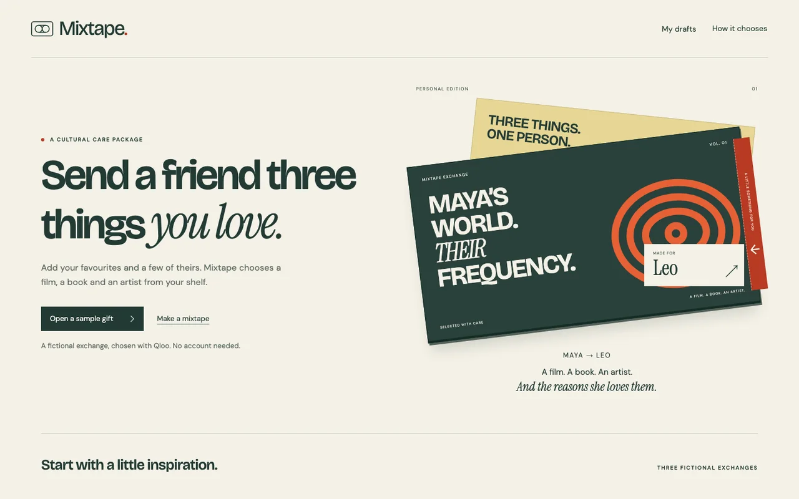
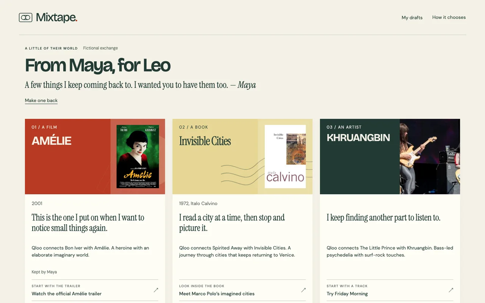
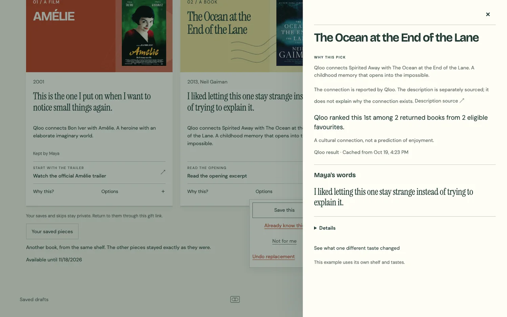

# Mixtape

Send a friend a film, a book and an artist you love, chosen from your favourites to meet their tastes.



Add your favourites and a few of theirs. Open the gift, add your own notes and share a link. The recipient can save a piece, replace one they already know, inspect **Why this?**, or make one back. No account required.

## How it chooses

**Qloo** resolves cultural identities and ranks only the sender’s approved favourites against the recipient’s declared tastes. Its cross-category connections, ranks and provenance remain inspectable. **Claude Haiku**, through the AI SDK’s tool loop and Anthropic API, chooses tools, reads those results, retries eligible subsets and commits a validated selection or asks for input. It cannot invent shelf items or override Qloo’s ranking. Personal names and notes stay out of the model context.

Runs have bounded calls, time and spend; the default model is `claude-haiku-5-5`, with a $3 daily cap. An explicit deterministic outage mode is labelled in the UI. Offline samples use synthetic data and never call either provider.




## Run locally

Use Bun 1.4.2 or later (Node.js 24 is also supported for npm tooling).

```sh
bun install --frozen-lockfile
cp .env.example .env.local
bun --bun next dev
```

Open http://localhost:3000. Leave optional entries empty; leave runtime-managed `NODE_ENV` and `PORT` unset. With no credentials, sample mode works offline. Without Valkey, local drafts and links live in memory and disappear on restart.

For live generation, set `QLOO_API_KEY` and `ANTHROPIC_API_KEY`. To install the live starters and comparisons, connect an isolated local Valkey and run `bun run release`; see [configuration](docs/configuration.md). Every supported variable is listed, without values, in [.env.example](.env.example).

```sh
bun run typecheck
bun run lint
bun run test
bun --bun next build
bun --bun next start
```

Storage tests require `redis-server` on PATH and start isolated local instances.

`bun run test:e2e` runs the offline browser suite against a production build using the pinned Playwright Chromium headless shell. `bun run test:e2e:live` is opt-in and uses paid providers and private manifests.

## Deploy on ShipTiffin

[tiffin.config.ts](tiffin.config.ts) declares project `mixtape` and one Next.js `web` app at `.`. ShipTiffin builds and starts it on Bun and supplies the Next.js adapter and project services. No custom service options or database migrations are needed.

Set four values on the intended box, then deploy from this checkout. The shell variables below are privately supplied values, never committed:

```sh
tiffin secrets set mixtape QLOO_API_KEY --value "$QLOO_API_KEY"
tiffin secrets set mixtape ANTHROPIC_API_KEY --value "$ANTHROPIC_API_KEY"
tiffin secrets set mixtape SESSION_SECRET --value "$SESSION_SECRET"
tiffin secrets set mixtape APP_ORIGIN --value "$APP_ORIGIN"
tiffin deploy
```

Use a stable random session secret of at least 32 characters and the canonical HTTPS origin without a trailing slash. No separate share secret is needed.

The release hook initializes missing quota records and automatically installs three curated live samples and five saved comparisons using Qloo and Haiku. It skips completed work, preserves live counters, and caps warming at 30 Qloo attempts and $0.10 of bounded model cost per release. If warming fails, the app still serves and reports unavailable samples.

Defaults: public mode and edge IP trust on Tiffin; 150 Qloo attempts/day, 2,500 per project allowance, one total-counter reset on November 18, 2026 UTC, Qloo access through November 30, and model caps of $3/day and $25 total. ShipTiffin supplies the storage URLs. No manual seed step or private files are needed. See [configuration](docs/configuration.md) for exact dates, optional limits and release behavior.

Gift links and drafts expire after 30 days. Valkey uses non-expiring keys with logical expiry for durable records, and expiring cache keys. Back up the project and retain its session secret.

## License

[MIT](LICENSE) © 2026 Bilal Tahir. Bundled fonts retain their [own licences](public/fonts/README.md); third-party catalog data and artwork are not covered by the code licence.
