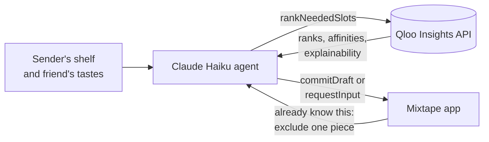
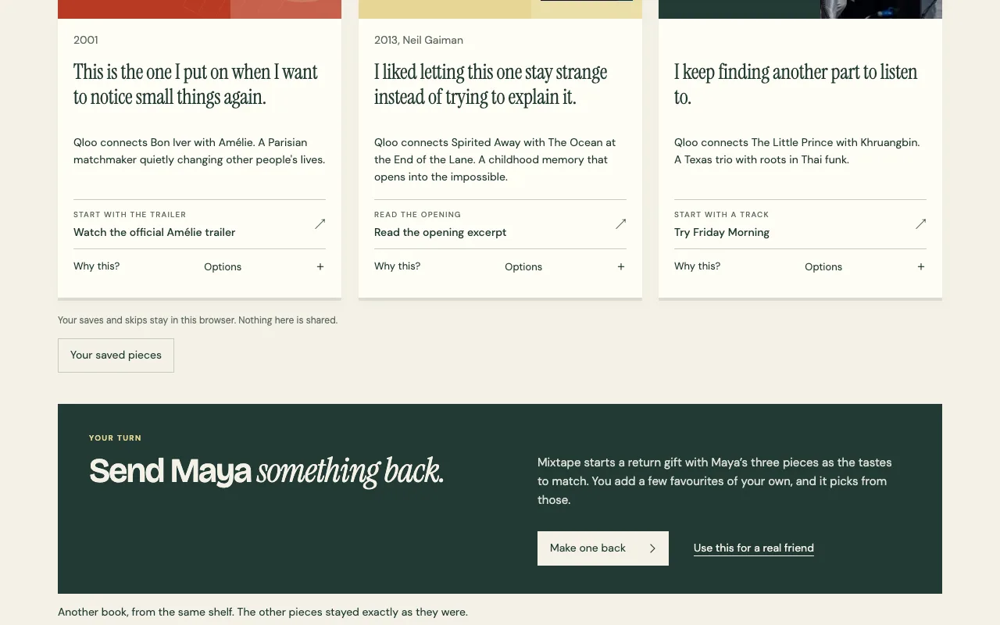

# Mixtape

Send a friend a film, a book and an artist you love, picked from your favourites to match their tastes.

### [Try it live → mixtape.shiptiffin.app](https://mixtape.shiptiffin.app)

Built for the [Qloo Agentic Hackathon 2026](https://qloo.devpost.com/). No account needed. Open the sample gift on the homepage to see the whole exchange in under a minute.


## How it works

1. **Fill your shelf.** Add at least two films, two books and two artists you love, then three or more things your friend likes.
2. **Mixtape picks one of each.** Qloo ranks your favourites against your friend's tastes. The agent checks the result and commits the strongest film, book and artist. You write a short note for each.
3. **They open it, and can send one back.** Your friend gets a link to a small parcel that opens into three pieces. If they already know one, they ask for another and only that piece changes. "Make one back" starts their reply with your three pieces as the tastes to match.


## Qloo and the agent



**Qloo does the taste work.** It resolves each title to a Qloo entity, then ranks only the sender's confirmed favourites (`filter.results.entities`) against the friend's tastes (`signal.interests.entities`), with explainability turned on. Every pick keeps its rank, affinity score and the reported connection to one of the friend's tastes. "Why this?" shows that evidence.

**The agent does the deciding.** Claude Haiku runs a bounded tool loop through the AI SDK. It chooses when to rank, reads the results, retries a slot only when the inputs changed, and then either commits a validated pick or stops to ask for more favourites. It cannot add items that are not on the shelf, reorder Qloo's ranking, or write the sender's notes. Names and notes never reach the model.

When the recipient marks a piece as known, the same loop runs again for that one slot, with the shown pieces excluded. The other two pieces stay as they were.



Each run has caps on tool calls, time and spend (default model `claude-haiku-5-5`, $3 a day). If the model is unavailable, a clearly labelled outage mode picks with Qloo alone. Offline sample mode uses illustrative data and calls neither service.


## Tech stack

- Next.js 16 (App Router, Cache Components) on Bun
- Qloo Insights and Search APIs
- Claude Haiku through the AI SDK and `@ai-sdk/anthropic`
- Valkey for drafts, links and caches (in memory when run locally)
- Playwright and Vitest for tests

## Run locally

You need Bun 1.4.2 or later.

```sh
bun install --frozen-lockfile
cp .env.example .env.local
bun --bun next dev
```

Open http://localhost:3000. With no keys, the app runs in offline sample mode. To make real picks, set `QLOO_API_KEY` and `ANTHROPIC_API_KEY` in `.env.local`. Without Valkey, drafts and links live in memory until you restart. [docs/configuration.md](docs/configuration.md) covers the optional settings and how to install the live samples.

```sh
bun run typecheck
bun run lint
bun run test        # storage tests need redis-server on PATH
bun run test:e2e    # offline browser suite against a production build
```

`bun scripts/social-preview.tsx` redraws the social preview and app icons.

## Deploy on ShipTiffin

[tiffin.config.ts](tiffin.config.ts) declares the `mixtape` project with one Next.js app. ShipTiffin builds it, runs it on Bun and provides Valkey. Set four secrets on the box, then deploy:

- `QLOO_API_KEY`
- `ANTHROPIC_API_KEY`
- `SESSION_SECRET` (a stable random string of at least 32 characters)
- `APP_ORIGIN` (the public HTTPS origin, no trailing slash)

```sh
tiffin secrets set mixtape QLOO_API_KEY --value "$QLOO_API_KEY"   # and the other three
tiffin deploy
```

The release hook warms the three live samples and the saved comparisons, capped at 30 Qloo calls and $0.10 of model spend per release. Gift links and drafts expire after 30 days. See [docs/configuration.md](docs/configuration.md) for limits and dates.

## License

[MIT](LICENSE) © 2026 Bilal Tahir. Bundled fonts keep their [own licences](public/fonts/README.md). Catalog data and artwork from third parties are not covered by the code licence.
